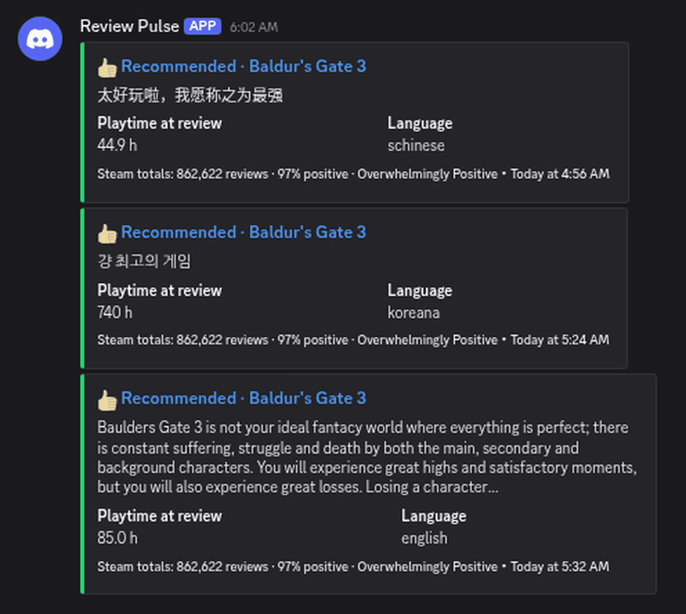

# Review Pulse for Steam

A tiny self-hosted script that watches **one Steam game** and posts every **new** Steam review to a Discord channel. Use a private dev channel so you see feedback as it lands, without refreshing your store page.

<!-- SCREENSHOT PLACEHOLDER: add docs/screenshot.png (Discord channel with 3 posted reviews) and replace this comment with:
 -->

Free, MIT-licensed, one Python file, **no dependencies** (standard library only), **no API keys** (it uses Steam's public review endpoint).

Each post shows:
- 👍 Recommended or 👎 Not recommended (green or red)
- a review excerpt (up to 300 characters, BBCode stripped)
- playtime at review and the review's language
- a link to the review on Steam
- Steam's own totals in the footer: total reviews, % positive and Steam's label (for example "Very Positive")

It doesn't score or judge anything itself. Every number comes straight from Steam's `query_summary`. The only arithmetic is "% positive", which is `total_positive / total_reviews` from that same response.

## Quick start (Python 3.9+)
```bash
cp .env.example .env        # then fill in STEAM_APP_ID and DISCORD_WEBHOOK_URL
python review_pulse.py      # one check, then exit
python review_pulse.py --every 15   # keep running, check every 15 minutes
```
Or with flags: `python review_pulse.py --app 620 --every 15`. Environment variables override `.env`.

**Discord webhook:** open the channel's settings > Integrations > Webhooks > New Webhook > Copy Webhook URL. Anyone with that link can post to the channel, so keep it secret.

## How it avoids duplicates
- It remembers posted review IDs in `review_pulse_state.json`. Keep that file, or the `/data` volume in Docker.
- On the very first run it posts only the newest `FIRST_RUN_POSTS` reviews (default 3) so you can see it working. Everything older is the baseline and is never posted.
- A review is marked as seen **only after Discord accepts the post** (HTTP 2xx). If Discord is down or the link is wrong, those reviews are retried on the next check. When Discord rate-limits a post (HTTP 429), it waits and retries.
- It posts up to 10 reviews per Discord message and at most `MAX_POSTS_PER_RUN` (default 20) per check. The rest go out on the next check.
- Mentions in review text (`@everyone`, user or role mentions) never ping anyone.

## Settings
| Variable / flag | Default | Meaning |
|---|---|---|
| `STEAM_APP_ID` / `--app` | (required) | Your game's app ID from `store.steampowered.com/app/<ID>/` |
| `DISCORD_WEBHOOK_URL` | (empty) | Without it, new reviews are printed and **not** marked as seen |
| `CHECK_EVERY_MINUTES` / `--every` | 0 | 0 = check once and exit (good for cron); otherwise loop |
| `FIRST_RUN_POSTS` / `--first-run-posts` | 3 | Reviews posted on the very first run |
| `MAX_POSTS_PER_RUN` / `--max-posts` | 20 | Cap per check |
| `STATE_FILE` / `--state` | `review_pulse_state.json` | Seen-review memory |
| `DATA_DIR` | (unset) | If set, the state file is stored there (Docker uses `/data`) |

## Docker
```bash
docker build -t review-pulse .
docker run -d --restart unless-stopped --env-file .env -v $PWD/data:/data review-pulse
```

## Cron (one check every 15 minutes)
```
*/15 * * * * cd /path/to/review-pulse && /usr/bin/python3 review_pulse.py >> pulse.log 2>&1
```

## Good to know
- Totals cover **all languages and all purchase types** (`language=all`, `purchase_type=all`). Your store page's headline number may differ slightly, because Steam's default store view can filter by purchase type and language.
- Steam's review list can lag. In our test, one response was about an hour behind, so a later check posted a burst of reviews that were real and new, not repeats. It's built for indie-sized review volume. A huge game will hit the per-check cap often.
- Each check reads up to 300 of the newest reviews. If your game gets more than that between checks, check more often.
- Steam's review endpoint is public but undocumented. Valve can change or limit it at any time. Keep checks to every few minutes or more.

## Tests
```bash
python -m unittest -v test_review_pulse
```
10 unit tests cover formatting, first-run baseline, no duplicates, failed posts being retried, 429 retry, mention safety, batching and the per-run cap.

**QA status (Oct 19, 2026):**
- **Tested live:** posting to a real Discord channel for a game with active reviews, using the one-shot and loop modes. A second run posted no duplicates, and the footer totals matched Steam's API.
- **Not tested yet:** the Dockerfile. It wasn't built in QA (no Docker on the test machine). Windows hasn't been tested either. It's plain Python, so it should run, but it hasn't been run there.

## License
MIT, see `LICENSE`. Not affiliated with Valve or Discord. Steam is a trademark of Valve Corporation.

## More from BotDrop
Free and paid self-hosted Discord and Steam bots, including Intel for Steam (review themes, review-bomb alerts and a daily competitor digest): [getbotdrop.com](https://getbotdrop.com/)
